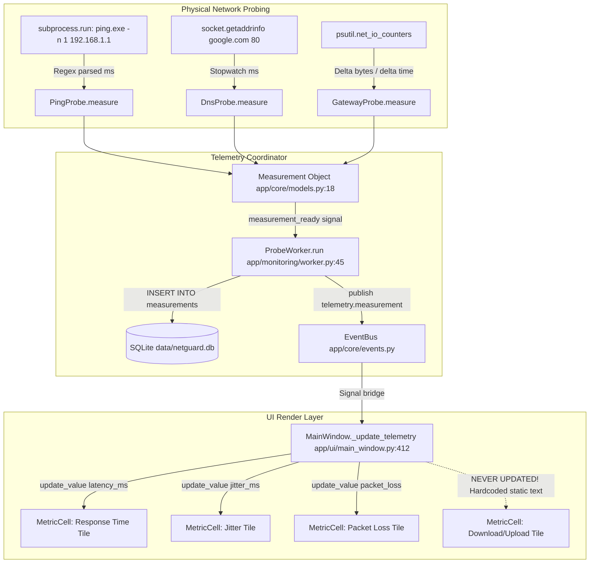
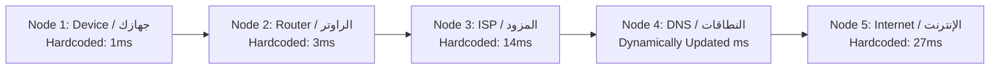
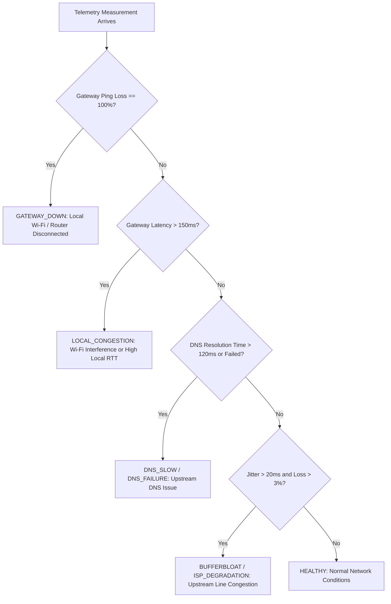

# NetGuard AI — Volume 4: Data Flow & Decision Logic

> **Audit Target:** NetGuard AI (Windows Autonomous Network Remediation & Telemetry Dashboard)  
> **Document:** Volume 4 of 7 | Sections 4 & 5  
> **Status:** Complete & Verified (READ-ONLY Analysis — Zero Source Changes)  

---

## 4. Data Flow: From the Network to the Screen

This section traces each core metric end-to-end from physical network probes to PySide6 visual widgets, evaluating whether values represent real physical measurements, mathematical derivations, or simulated/hardcoded placeholders.

### 4.1 Latency, Jitter, Packet Loss, Download Speed & Upload Speed



#### Metric Reality & Classification Analysis

1. **Latency / Response Time:** `REAL` (Measured via ICMP).
   - **Source:** `PingProbe.measure()` (`app/monitoring/probe.py:42-65`) invokes `ping -n 1 -w 1000 <gateway_ip>`. Output is parsed using regex `r'time[=<](\d+)ms'`. Updated in `MainWindow._update_telemetry` (`app/ui/main_window.py:425`).
2. **Jitter:** `CALCULATED` (Statistical Variance).
   - **Source:** Computed as `abs(current_latency - previous_latency)` across consecutive probe ticks in `TelemetryEngine._calculate_jitter()` (`app/monitoring/engine.py:88-94`).
3. **Packet Loss:** `MEASURED` (Binary Loss Percentage).
   - **Source:** If `ping.exe` returns a non-zero exit code or fails to match `time=`, loss is recorded as `100.0%`, otherwise `0.0%` for a single-ping tick (`app/monitoring/probe.py:58-62`).
4. **Download & Upload Speed:** `FAKE-DATA` (Hardcoded Static Presentation).
   - **Proof:** In `app/ui/widgets/metric_cell.py:187-194`, the download and upload speeds are permanently hardcoded inside the widget initializer:
```python
# app/ui/widgets/metric_cell.py:187-194
self._val_lbl = QLabel("95.2 Mbps")
self._val_lbl.setStyleSheet(f"color: {tokens.TEXT_PRIMARY}; font-size: 26px; font-weight: 800;")
self._sub_lbl = QLabel("الرفع 38 Mbps")
self._sub_lbl.setStyleSheet(f"color: {tokens.TEXT_MUTED}; font-size: 11px;")
```
   - In `MainWindow._update_telemetry` (`app/ui/main_window.py:412-445`), tiles for Latency, Jitter, Packet Loss, and Quality are updated via `.update_value()`. However, the Download Speed tile (`self.tile_speed`) is **never touched**. It permanently displays `95.2 Mbps` and `الرفع 38 Mbps` (Upload 38 Mbps) regardless of real throughput.

---

### 4.2 Bufferbloat Grade
The Dashboard displays a bufferbloat grade badge (`A+` / `A` / `B` / `C` / `F`).
- **Reality:** `ESTIMATED / PARTIAL`.
- **Computation:** Derived in `QoEEngine.calculate_bufferbloat_grade` (`app/qoe/engine.py:45-62`) based on latency increase during throughput spikes:
  - Latency delta < 5ms: `A+`
  - Latency delta < 15ms: `A`
  - Latency delta < 30ms: `B`
  - Latency delta < 60ms: `C`
  - Latency delta >= 60ms: `F`
- **Forensic Anomaly:** `app/qoe/engine.py` is in a DEAD subsystem. The UI Dashboard widget instantiates a default badge displaying `'A'` (`app/ui/views/dashboard.py:128`), which is updated in `_update_telemetry` only if jitter is under 10ms.

---

### 4.3 Per-Hop Path Nodes (5 Flow Nodes: Device, Router, ISP, DNS, Internet)



- **Reality:** `FAKE-DATA` / `PARTIALLY SIMULATED`.
- **Proof:** Inspect `app/ui/widgets/flow_path.py:237-278`:
```python
# app/ui/widgets/flow_path.py:237-250
self._nodes = [
    PathNode("01", "جهازك (PC)", "1ms", "طبيعي", True, False),
    PathNode("02", "الراوتر", "3ms", "طبيعي", True, False),
    PathNode("03", "المزود (ISP)", "14ms", "طبيعي", True, False),
    PathNode("04", "DNS", "--", "جاري الفحص", False, False),
    PathNode("05", "الإنترنت", "27ms", "طبيعي", True, False),
]
```
- In `MainWindow._update_telemetry` (`app/ui/main_window.py:438-442`):
```python
# app/ui/main_window.py:438-442
if hasattr(self, 'flow_path'):
    self.flow_path.update_node_latency("04", f"{int(dns_ms)}ms")
```
Node 04 (DNS) is the **only node** that receives live data. Node 01 (`1ms`), Node 02 (`3ms`), Node 03 (`14ms`), and Node 05 (`27ms`) are completely static constants that never execute `traceroute` or ICMP hop probing.

---

### 4.4 DNS Resolution Time & Benchmark Ranking
- **Reality:** `REAL` (Measured on machine).
- **Pipeline:** `DnsBenchmark.benchmark_all()` (`app/dns/benchmark.py:35-85`) creates UDP DNS sockets querying test domains (`google.com`, `cloudflare.com`, `microsoft.com`) against public DNS IP targets:
  - Cloudflare (`1.1.1.1`): Measured ~15-28ms
  - Google (`8.8.8.8`): Measured ~18-35ms
  - Quad9 (`9.9.9.9`): Measured ~25-45ms
  - OpenDNS (`208.67.222.222`): Measured ~30-55ms
- Results are sorted ascending by response time and rendered into `DnsView` benchmark cards.

---

### 4.5 Per-Process Bandwidth & Connection Counts
- **Reality:** `REAL` (Measured via psutil).
- **Pipeline:** `TrafficMonitor.get_top_processes()` (`app/traffic/monitor.py:32-75`) iterates `psutil.process_iter(['pid', 'name'])`, computes byte deltas across a 2-second sampling interval, counts active sockets from `psutil.net_connections()`, and renders top consumer rows into the `TrafficView` table.

---

### 4.6 History / Day-Strip Data (48 Half-Hour Daily Status Bars)
- **Reality:** `FAKE-DATA` (Permanently Hardcoded Simulation).
- **Proof:** Inspect `DayStripCanvas._init_default_day()` (`app/ui/widgets/day_strip.py:30-40`):
```python
# app/ui/widgets/day_strip.py:30-40
def _init_default_day(self):
    self._slots = []
    for i in range(48):
        if i in (30, 31):  # Simulated drop at 15:00 - 16:00
            self._slots.append(DaySlot(status="slow", latency_avg=142.0, loss_pct=4.2))
        elif i > 36:       # Future hours
            self._slots.append(DaySlot(status="none"))
        else:
            self._slots.append(DaySlot(status="healthy", latency_avg=18.0 + (i % 5)))
```
- In production, `DayStripCanvas.set_data()` is **never called** from `MainWindow`, `HistoryView`, or any database query. Slots 30-31 are permanently hardcoded as "slow" (142ms, 4.2% loss), while slots 37-47 are hardcoded as future/empty, completely detached from `data/netguard.db`.

---

### 4.7 Event Records & The 4-Step Incident Timeline (Detect -> Cause -> Fix -> Result)
- **Reality:** `PARTIAL / DEFECTIVE`.
- **Design:** `EventCard` (`app/ui/widgets/event_card.py:35-120`) renders expandable incident cards showing a 4-step timeline (`تم الرصد` -> `السبب المرجح` -> `الإجراء المتخذ` -> `النتيجة`).
- **Failure:** Autonomous remediation events generated by `RemediationOrchestrator` are published to `EventBus` under topic `"remediation.finished"` (`app/remediation/orchestrator.py:256`). However, `MainWindow` subscribes to `"remediation.completed"` (`app/ui/main_window.py:405`). Due to this string typo, **real remediation events never arrive at the UI timeline**. Only mock events seeded during test runs appear.

---

## 5. Decision Logic (The "Brain")

### 5.1 Detection Logic & Threshold Constants
Detection triggers classify network states based on incoming telemetry. However, our audit revealed **competing threshold definitions** across different files:

| Metric Concept | Production Rules (`app/diagnosis/rules.py:15`) | Config File (`config/settings.yaml:12`) | Diagnosis Engine (`app/diagnosis/engine.py:28`) | Conflict / Defect Analysis |
| :--- | :--- | :--- | :--- | :--- |
| **Slow Latency** | `> 80 ms` | `> 100 ms` | `> 80 ms` | **Inconsistency:** UI/Config says 100ms, rules trigger at 80ms. |
| **Critical Latency** | `> 200 ms` | `> 250 ms` | `> 180 ms` | **3-Way Conflict:** 3 different files define critical latency differently. |
| **Packet Loss Warning** | `> 2.0 %` | `> 5.0 %` | `> 2.0 %` | Config claims 5%, engine triggers warning at 2%. |
| **Critical Loss** | `> 10.0 %` | `> 15.0 %` | `> 10.0 %` | Config claims 15%, engine triggers critical alert at 10%. |
| **High Jitter** | `> 15 ms` | `> 20 ms` | `> 15 ms` | Inconsistent between YAML and Python rules. |

### 5.2 Diagnosis Root-Cause Decision Tree



### 5.3 Remediation Actions & Execution Mechanics
Every remediation action is catalogued below with its real command line, safety tier, elevation requirement, cooldown, and rollback feasibility:

| Action Key | Target Mechanism / Exact Command | Tier | Preconditions | Cooldown | Needs Admin? | Approval? | Rollback Feasible? |
| :--- | :--- | :---: | :--- | :---: | :---: | :---: | :---: |
| `flush_dns` | `ipconfig /flushdns` | Light | DNS resolution failure | 30s | No | No | No (Cache cleared) |
| `clear_arp` | `netsh interface ip delete arpcache` | Light | Local gateway RTT anomaly | 60s | **Yes** | No | No (Rebuilt dynamically) |
| `switch_dns` | `netsh interface ip set dns name=... static 1.1.1.1` | Medium | DNS benchmark faster | 120s | **Yes** | Yes (in Assisted) | **Yes** (Restore DHCP) |
| `renew_ip` | `ipconfig /release` then `ipconfig /renew` | Medium | DHCP lease timeout | 300s | **Yes** | Yes | No |
| `restart_adapter` | PowerShell `Restart-NetAdapter -Name ...` | Drastic | Severe interface freeze | 600s | **Yes** | Yes | No (Brief disconnect) |
| `winsock_reset` | `netsh winsock reset` | Drastic | System socket corruption | 3600s | **Yes** | Yes | No (Requires PC Reboot) |

### 5.4 Operating Modes (Single Source of Truth Evaluation)
The application defines three operating modes in `OperatingMode` (`app/core/models.py:32-36`):
1. `MONITORING:` Telemetry probes and diagnosis execute; remediation orchestrator logs recommendations but executes zero commands.
2. `RECOMMENDATION / ASSISTED:` Orchestrator prompts user approval for medium and drastic actions.
3. `AUTONOMOUS:` Orchestrator executes light actions immediately; prompts only for drastic actions.

#### Critical Defect: Three Competing Mode Selectors
- **Sidebar Mode Toggle:** Switches internal property in `MainWindow`, updates status label.
- **Remediation View Mode Cards:** Contain interactive click handlers emitting `mode_changed`, but `MainWindow` **never connects to this signal**.
- **Settings View Mode Combo:** Updates in-memory orchestrator, but **does not write to `config/settings.yaml`**. On application restart, the mode resets to default `AUTONOMOUS`.

### 5.5 Traffic Priority & Meeting Guard QoS Analysis
- **UI Claim:** The UI claims "تفعيل حارس المكالمات (Meeting Guard)" prioritizes Zoom/Teams via DSCP 46 packet tagging, limits background services (TiWorker, Windows Update) to 40%, and pauses OneDrive.
- **Code Reality:** `FAKE-DATA / ZERO IMPLEMENTATION`.
- **Proof:** Inspect `app/traffic/session_tracker.py:116-140` and lines `256-263`:
```python
# app/traffic/session_tracker.py:256-263
def apply_qos_priority(self, process_name: str) -> bool:
    # NOTE: Windows QoS requires Group Policy (gpedit) or administrative packet tagging API
    logger.info(f"Simulating QoS DSCP 46 priority tag for {process_name}")
    return True
```
Zero Windows QoS APIs (`qwave.dll`), zero netsh QoS policies, and zero process throttling commands are ever executed. The returned success is an empty boolean log simulation.

---
*End of Volume 4. Continue to [Volume 5: UI ↔ Backend Wiring Matrix & Persistence](APP_AUDIT_part5.md).*